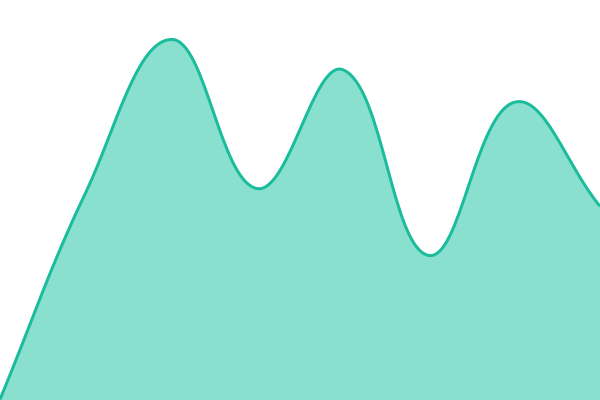

# Occult Lab status

This repository contains the open-source uptime monitor and status page for [Occult Lab Code](https://occult-lab.github.io/occult-status), powered by [Upptime](https://github.com/upptime/upptime).

## Live status: <!--live status--> **🟩 All systems operational**

<!--start: status pages-->
<!-- This summary is generated by Upptime (https://github.com/upptime/upptime) -->
<!-- Do not edit this manually, your changes will be overwritten -->
<!-- prettier-ignore -->
| URL | Status | History | Response Time | Uptime |
| --- | ------ | ------- | ------------- | ------ |
|  [Occult API](https://api.occultapi.com/api/health/) | 🟩 Up | [occult-api.yml](https://github.com/occult-lab/occult-status/commits/HEAD/history/occult-api.yml) | 

 505ms
     
 | 

<a href="https://occult-lab.github.io/occult-status/history/occult-api">100.00%</a>
    

|  [Occult API website](https://occultapi.com) | 🟩 Up | [occult-api-website.yml](https://github.com/occult-lab/occult-status/commits/HEAD/history/occult-api-website.yml) | 

 318ms
     
 | 

<a href="https://occult-lab.github.io/occult-status/history/occult-api-website">100.00%</a>
    

|  [Occult API docs](https://occultapi.com/docs) | 🟩 Up | [occult-api-docs.yml](https://github.com/occult-lab/occult-status/commits/HEAD/history/occult-api-docs.yml) | 

 181ms
     
 | 

<a href="https://occult-lab.github.io/occult-status/history/occult-api-docs">100.00%</a>
    

|  [Occult API MCP server](https://api.occultapi.com/api/docs/index/) | 🟩 Up | [occult-api-mcp.yml](https://github.com/occult-lab/occult-status/commits/HEAD/history/occult-api-mcp.yml) | 

 1064ms
     
 | 

<a href="https://occult-lab.github.io/occult-status/history/occult-api-mcp">100.00%</a>
    

|  [Yogatara website](https://yogatara.app) | 🟩 Up | [yogatara-website.yml](https://github.com/occult-lab/occult-status/commits/HEAD/history/yogatara-website.yml) | 

 247ms
     
 | 

<a href="https://occult-lab.github.io/occult-status/history/yogatara-website">100.00%</a>
    

|  [Yogatara app and website API](https://yogataraapi.prahlad.app/api/health/) | 🟩 Up | [yogatara-api.yml](https://github.com/occult-lab/occult-status/commits/HEAD/history/yogatara-api.yml) | 

 547ms
     
 | 

<a href="https://occult-lab.github.io/occult-status/history/yogatara-api">100.00%</a>
    

|  [Yogatara login and accounts](https://yogataraapi.prahlad.app/dj-rest-auth/user/) | 🟩 Up | [yogatara-login.yml](https://github.com/occult-lab/occult-status/commits/HEAD/history/yogatara-login.yml) | 

 427ms
     
 | 

<a href="https://occult-lab.github.io/occult-status/history/yogatara-login">100.00%</a>
    

|  [Yogatara Jyotisha AI](https://yogataraapi.prahlad.app/api/health/?component=ai) | 🟩 Up | [yogatara-ai.yml](https://github.com/occult-lab/occult-status/commits/HEAD/history/yogatara-ai.yml) | 

 497ms
     
 | 

<a href="https://occult-lab.github.io/occult-status/history/yogatara-ai">100.00%</a>
    

|  [Yogatara courses](https://yogataraapi.prahlad.app/api/courses/) | 🟩 Up | [yogatara-courses.yml](https://github.com/occult-lab/occult-status/commits/HEAD/history/yogatara-courses.yml) | 

 403ms
     
 | 

<a href="https://occult-lab.github.io/occult-status/history/yogatara-courses">100.00%</a>
    

|  [Yogatara community](https://community.yogatara.app) | 🟩 Up | [yogatara-community.yml](https://github.com/occult-lab/occult-status/commits/HEAD/history/yogatara-community.yml) | 

 207ms
     
 | 

<a href="https://occult-lab.github.io/occult-status/history/yogatara-community">100.00%</a>
    

|  [Yoga Panchang website](https://yogapanchang.com) | 🟩 Up | [yogapanchang-website.yml](https://github.com/occult-lab/occult-status/commits/HEAD/history/yogapanchang-website.yml) | 

 586ms
     
 | 

<a href="https://occult-lab.github.io/occult-status/history/yogapanchang-website">100.00%</a>
    

|  [Yoga Panchang daily panchang](https://yogapanchang.com/panchang/dainik) | 🟩 Up | [yogapanchang-daily-panchang.yml](https://github.com/occult-lab/occult-status/commits/HEAD/history/yogapanchang-daily-panchang.yml) | 

 426ms
     
 | 

<a href="https://occult-lab.github.io/occult-status/history/yogapanchang-daily-panchang">100.00%</a>
    

|  [Yoga Panchang calculators](https://yogapanchang.com/ram-shalaka-prashnavali) | 🟩 Up | [yogapanchang-calculators.yml](https://github.com/occult-lab/occult-status/commits/HEAD/history/yogapanchang-calculators.yml) | 

 178ms
     
 | 

<a href="https://occult-lab.github.io/occult-status/history/yogapanchang-calculators">100.00%</a>
    

<!--end: status pages-->

Configuration: [`.upptimerc.yml`](./.upptimerc.yml). Setup: [`SETUP.md`](./SETUP.md).
The workflows under `.github/workflows` are generated by Upptime; change the
configuration, not the workflows.
